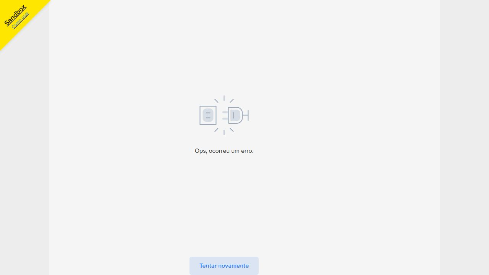

# Retorno ao suporte: OAuth e links do Checkout Pro

**Atualização às 20:24 de Brasília:** o teste OAuth com `test_token=true` foi
autorizado e executado. Retornou credencial TEST e o vendedor esperado; o Pix
continuou falhando com `user_allowed_only_in_test`. O acesso APP_USR do Checkout
Pro foi restaurado. Consulte o [relatório Pix sandbox](mercadopago-pix-sandbox-2026-10-11.md).
As observações abaixo registram o diagnóstico anterior, das 16:15.

A resposta recebida esclarece que não há uma chave separada para habilitar
Marketplace. A investigação deve tratar a compatibilidade do grant OAuth e o
ambiente suportado pelo Checkout Pro / Preferences API. A existência de uma
habilitação específica não foi demonstrada pelos testes anteriores.

## Confirmações objetivas

- Ambiente do WODZ: desenvolvimento, `MP_TEST_MODE=true`.
- Comprador e vendedor: contas fictícias brasileiras e diferentes entre si.
- `/users/me` com o OAuth do WODZ confirmou vendedor `3740570257`, tag
  `test_user`, país MLB e conta ativa.
- A preferência confirmou o mesmo collector e a aplicação `6035581613565283`.
- O WODZ envia `test_token=false` tanto ao trocar o código quanto ao renovar
  OAuth. A credencial é `APP_USR` e o provedor informa `live_mode=true`.
- O WODZ abre `init_point`. Backend e frontend atualmente não permitem
  `sandbox_init_point` no fluxo da inscrição.
- A preferência mínima não tem URLs de retorno ou notificação, expiração ou
  comissão. Falhou usando o link normal.

## Links exatos retornados pela API

Consulta em 11/10/2026 às 16:15:23 em Brasília. Não foi criada outra preferência
nem alterada a autorização. Apenas os links e identificadores públicos foram
preservados em `mercadopago-oauth-links-2026-10-11.json`.

```json
{
  "id": "3740570257-5f1d125d-5108-489e-ab65-0d137a852272",
  "init_point": "https://www.mercadopago.com.br/checkout/v1/redirect?pref_id=3740570257-5f1d125d-5108-489e-ab65-0d137a852272",
  "sandbox_init_point": "https://sandbox.mercadopago.com.br/checkout/v1/redirect?pref_id=3740570257-5f1d125d-5108-489e-ab65-0d137a852272"
}
```

## Teste da orientação sobre URL

Foi aberto diretamente o `sandbox_init_point` acima, fora do WODZ, mantendo a
mesma preferência e credencial de criação. O checkout exibiu a identificação
Sandbox, o comprador fictício já autenticado, saldo R$ 9.790,00 e valor R$ 210,00.
Ao clicar em Pagar com saldo, retornou novamente “Ops, ocorreu um erro.”

Checkout flow ID: `36e28138-1f63-4a85-b7ec-b9883811d5f6`.



Esse teste demonstra que **mudar apenas a URL não resolveu com a credencial
OAuth atual**. Não substitui o teste de um novo grant com `test_token=true`.
O controle anterior aprovado usou APP_USR direto do vendedor, link normal,
as mesmas contas e outra aplicação; pagamento `182637234147`.

## Questão que permanece

A documentação genérica OAuth orienta `test_token=true` para credenciais
sandbox. A documentação específica Checkout Pro informa que credenciais das
contas fictícias do vendedor começam com APP_USR. O controle aprovado também
teve `live_mode=true`. Isso não permite usar somente prefixo ou esse campo para
afirmar que contas fictícias estão pagando com dinheiro real.

Naquele momento, o teste de `test_token=true` **ainda não havia sido executado**.
A comparação foi posteriormente feita por renovação do grant existente, como
descrito no relatório Pix acima. Alterar apenas o booleano no
projeto não é um teste completo: o código também valida prefixo APP_USR e o host
normal no backend/frontend; eventual suporte a outro ambiente deve manter a
identidade do vendedor, a classificação da conta e as verificações financeiras.

Texto para enviar ao suporte, junto do JSON acima:

> Estamos em teste, com comprador e vendedor fictícios brasileiros. O OAuth
> usado para criar a preferência confirmou `/users/me.id=3740570257`, tag
> `test_user` e conta ativa. A preferência usa a aplicação `6035581613565283`.
> O OAuth foi obtido e renovado com `test_token=false`, retornando APP_USR e
> `live_mode=true`. Usávamos o `init_point` acima. Também abrimos exatamente o
> `sandbox_init_point` retornado para a mesma preferência e o pagamento com
> saldo voltou a falhar; fluxo `36e28138-1f63-4a85-b7ec-b9883811d5f6`.
> A preferência mínima não contém URLs de retorno ou notificação.
> Para Checkout Pro via Preferences API em Marketplace, com essas contas
> fictícias, devemos obter um NOVO grant OAuth com `test_token=true`? Qual
> prefixo e `live_mode` devem ser retornados, e qual link deve ser usado nesse
> modelo específico? A documentação Checkout Pro descreve APP_USR para contas
> fictícias e o controle direto com link normal foi aprovado (pagamento
> `182637234147`). Precisamos do procedimento específico para OAuth de vendedor
> de teste, distinguindo-o das credenciais diretas desse vendedor.

Nenhuma mensagem foi enviada ao suporte. Nenhum token, senha, cookie ou
identificador de sessão foi incluído nos artefatos. O OAuth e a configuração
global do WODZ não foram alterados nesta comparação.

Referências oficiais:

- [Marketplace no Checkout Pro](https://www.mercadopago.com.br/developers/pt/docs/checkout-pro-preferences/how-tos/integrate-marketplace).
- [OAuth e test_token](https://www.mercadopago.com.br/developers/pt/docs/security/oauth/creation).
- [Contas fictícias e APP_USR no Checkout Pro](https://www.mercadopago.com.br/developers/pt/docs/checkout-pro-preferences/test-accounts).
- [Controles anteriores](mercadopago-testes-controlados-2026-10-11.md).
