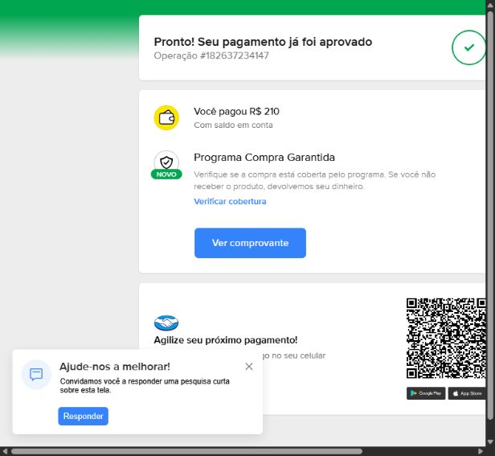
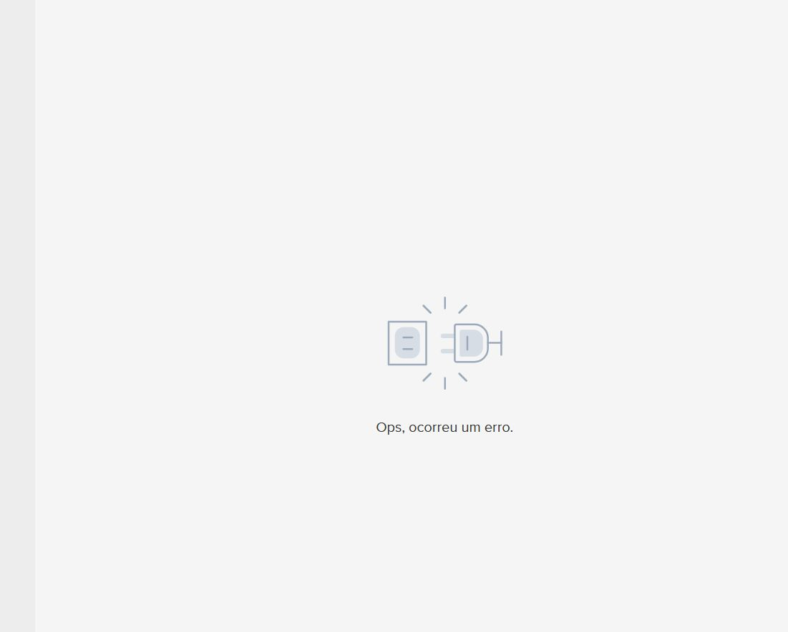

# Testes controlados do Checkout Pro — 11/10/2026

Atualização após retorno do suporte: [OAuth, links e teste sandbox](mercadopago-retorno-suporte-2026-10-11.md).
O link sandbox retornado pela API também falhou com a credencial OAuth atual.
Não foi demonstrada uma chave separada de habilitação Marketplace; a questão
pendente é o procedimento OAuth/ambiente específico para vendedores fictícios.

Foi possível entrar com o comprador fictício informado e concluir uma compra
fictícia de R$ 210,00. Nas mesmas contas, valor, moeda e sessão, o checkout com a
autorização OAuth do WODZ reproduziu “Ops, ocorreu um erro.”, mesmo com uma
preferência mínima. O resultado concentra a investigação na aplicação/grant
OAuth/Marketplace, mas não revela qual regra interna do Mercado Pago falha.

## Comparação executada

Comprador de teste `3744243828`, vendedor de teste brasileiro `3740570257`,
um item de R$ 210,00 em BRL e pagamento com saldo. O login foi realizado antes
dos checkouts. A API do vendedor confirmou `test_user`, país MLB e conta ativa.

| Controle | Credencial e aplicação | Preferência | Resultado |
| --- | --- | --- | --- |
| A: mínimo direto | Credencial direta do vendedor, app `5387756444859415` | `3740570257-521737ca-e903-486f-b325-52363b47ce97` | Aprovado; pagamento `182637234147` |
| B: mínimo OAuth | Autorização do vendedor armazenada pelo WODZ, app `6035581613565283` | `3740570257-5f1d125d-5108-489e-ab65-0d137a852272` | Tela de erro; zero pagamentos na API |
| C: WODZ completo | Mesmo OAuth da app `6035581613565283` | `3740570257-3b89501b-d76f-464e-b4b6-74531632af2b` | Tela de erro; zero pagamentos na API |
| D: WODZ atualizado | OAuth renovado e tipo de conta revalidado, app `6035581613565283` | `3740570257-001ca4fd-e366-4821-9380-21c765721402` | Tela de erro; zero pagamentos na API |

A e B enviaram apenas `items` e `external_reference`, com a mesma estrutura.
Não incluíram `payer`, comissão, URLs de retorno, `auto_return`, notificação ou
expiração. Cada controle tem uma referência própria, sem vínculo com a inscrição.
O script confirmou a identidade fictícia do vendedor antes de criar a preferência.
O OAuth foi lido e decifrado somente em memória, sem substituí-lo pela credencial
direta. A criação de B não renovou nem alterou a autorização conectada.

C foi aberto pelo endpoint público da inscrição pendente. O WODZ retomou a
preferência válida criada às 15:11:13.159; seu vencimento era 15:41:08.883.
A verificação das 15:35:22 confirmou que ela ainda estava válida e não tinha
pagamentos. O teste B não tinha expiração, portanto não depende desse prazo.

No controle A, a confirmação pela API às 15:25:26 encontrou exatamente um
pagamento `approved` / `accredited`, criado às 15:24:22, de R$ 210,00 com
`account_money`, **`live_mode=true`**. O saldo fictício do comprador mudou de
R$ 10.000,00 para R$ 9.790,00. A inscrição original não foi confirmada por A,
pois a referência desse controle é independente.





## Identificadores adicionais

| Controle | Checkout flow ID | Router request ID |
| --- | --- | --- |
| A | `7f0d7c7e-e92e-437a-8240-07951b9b0188` | `4beb9e13-bab2-4d5f-86a2-ba3d9f73ced0` |
| B | `5357c168-e412-4427-a42f-a3108759747f` | `0b0d87ba-bc79-4279-9c60-f960f15d94b7` |
| C | `35982d5f-287f-47b4-8396-516d310371dc` | `11f7b002-e146-489b-bf44-3274a3a61efc` |
| D | `85ce338c-e53f-4091-a0e3-04bb77d0623f` | `01e41641-6a9f-4d14-b213-df7b5e13649f` |

Consultas oficiais às 15:35 confirmaram B e C com zero pagamentos. A aplicação
603 estava ativa, não bloqueada, não desabilitada e com PKCE. A conta do integrador
é real; a do vendedor é fictícia. Essa diferença é uma hipótese de configuração,
não uma incompatibilidade demonstrada pela documentação.

Os resultados filtrados estão em:

- `mercadopago-minimal-checkout-2026-10-11.json`: criação e confirmação de A.
- `mercadopago-oauth-minimal-checkout-2026-10-11.json`: criação de B.
- `mercadopago-oauth-minimal-api-2026-10-11.json`: consulta de B.
- `mercadopago-wodz-checkout-2026-10-11.json`: abertura de C.
- `mercadopago-wodz-api-2026-10-11.json`: consulta de C.
- `mercadopago-wodz-atualizado-2026-10-11.json`: criação de D.
- `mercadopago-wodz-atualizado-api-2026-10-11.json`: consulta de D.

## Lacuna encontrada no WODZ

O código tratava a classificação `test_user` como se ela fosse o modo financeiro
`live_mode`: reescrevia o valor retornado pelo OAuth para `false` em contas de teste.
A compra aprovada A demonstra que contas fictícias do Checkout Pro podem produzir
pagamentos com `live_mode=true`. Essa inferência faria o WODZ rejeitar uma confirmação
legítima mesmo depois da aprovação pelo Mercado Pago.

A correção separa `test_account` (classificação obtida de `/users/me`) de
`live_mode` (valor literal do OAuth), mantendo as verificações de vendedor,
referência, valor, moeda e modo financeiro. Contas legadas sem classificação
passam por renovação OAuth e validação uma vez; a atualização é persistida
mesmo quando a operação posterior falha. Não basta inverter o booleano legado.

Essa lacuna atua na confirmação posterior. **Não explica a tela de erro em B/C**,
que ocorre antes de existir um pagamento. Os logs de preferência validada foram
acrescentados para correlacionar futuras tentativas sem registrar credenciais.

## Validação da correção no ambiente local

Backend e frontend foram reconstruídos e atualizados com Docker Compose, sem
recriar o banco. Flyway confirmou V23 (já existente no código, sobre manter
inscrições canceladas) e V24. O vínculo antigo começou com `live_mode=false` e
`test_account=NULL`; ao abrir o checkout atualizado, o WODZ renovou seu OAuth,
validou a identidade no Mercado Pago e persistiu **ambos os campos como `true`**.

D é uma nova cobrança, checkout ID 3, criada às 15:50:48, válida até 16:20:46.442.
O novo `X-Request-ID` da criação da preferência é
`201f09e2-3824-451f-86fe-bbbd5a7d4734`. Mesmo depois da renovação, o pagamento
com saldo reproduziu a tela de erro. A consulta financeira às 15:53:06 confirmou
zero pagamentos, pela autorização OAuth renovada. Isso também enfraquece a
hipótese de que apenas renovar um token antigo resolveria a falha do Marketplace.

Validação automatizada e compilação:

- Backend: relatórios atuais de 230 testes distintos, sem falhas ou erros,
  combinando a suíte completa e regressões finais. O teste novo de PostgreSQL/JPA
  teve seu setup restringido à entidade alterada, após expor um mapeamento
  preexistente de outra entidade; passou na execução final com PaymentService
  (22/22 nessa execução). Não se afirma que houve uma única execução completa
  limpa após essa correção do setup.
- Migração V23→V24 e atualização do contexto JPA verificadas em PostgreSQL 16.4
  temporário; webhook com dois vínculos do mesmo vendedor coberto por regressão.
- Frontend: typecheck e 98 testes passaram.
- Builds Docker do backend e frontend e `git diff --check` passaram.

O novo log INFO foi observado no backend durante a criação de D. Para futuras
tentativas, no terminal WSL usado pelo projeto:

```bash
docker compose logs --since 30m --no-color --timestamps backend \
  | grep -Ei 'Checkout Pro|OAuth do Mercado Pago|Validação da conta Mercado Pago|Vinculação Mercado Pago'
```

Esses logs confirmam criação/validação pelo WODZ e correlacionam IDs; o motivo
interno da falha ao pagar continua dependendo dos registros do Mercado Pago.

## Próximo passo sustentado pelas evidências

O fluxo Marketplace deve continuar usando OAuth. Trocar pelo token direto que
aprovou A mudaria o modelo e não resolveria a autorização da app 603. A documentação
de Split 1:1 exige OAuth do vendedor e qualificação KYC 6; conta ativa e sucesso
no checkout direto não comprovam elegibilidade para Marketplace.

O papel de Integrador de teste existe oficialmente. Um próximo experimento é
criar/configurar uma aplicação sob uma conta fictícia de Integrador, autorizar
o mesmo vendedor e repetir B. Isso exige outra configuração de aplicação e
autorização; não é uma correção garantida nem motivo para trocar credenciais
do projeto sem esse controle.

Mensagem pronta para consulta técnica ao Mercado Pago:

> Na aplicação Checkout Pro / Marketplace `6035581613565283`, a preferência
> mínima `3740570257-5f1d125d-5108-489e-ab65-0d137a852272`, criada com OAuth
> do vendedor de teste `3740570257`, falha ao pagar com saldo e não cria uma
> transação. O mesmo comprador de teste `3744243828`, vendedor, sessão, valor
> R$ 210,00, moeda BRL e estrutura mínima de payload concluiu o pagamento
> `182637234147`, aprovado, com credencial direta do vendedor na aplicação
> `5387756444859415`. Podem verificar a habilitação Split 1:1 e o grant OAuth
> da aplicação 603 para esse vendedor, incluindo elegibilidade/KYC e a regra
> para integrador real com vendedor/comprador fictícios? Qual configuração de
> aplicação e ambiente OAuth é suportada para esse teste? O fluxo que falhou
> é `5357c168-e412-4427-a42f-a3108759747f`, router request
> `0b0d87ba-bc79-4279-9c60-f960f15d94b7`. As capturas anteriores reproduzem
> `challenge=reauth` seguido de `service_error`, com request IDs preservados
> no relatório dos HARs. Uma renovação OAuth posterior também funcionou, mas
> a preferência nova `3740570257-001ca4fd-e366-4821-9380-21c765721402` voltou
> a falhar sem criar pagamento; fluxo `85ce338c-e53f-4091-a0e3-04bb77d0623f`,
> router `01e41641-6a9f-4d14-b213-df7b5e13649f`.

Nenhuma mensagem foi enviada ao suporte. Senhas, tokens, cookies, conteúdo
privado do banco e identificadores de sessão não foram incluídos nos artefatos.

Referências oficiais consultadas:

- [Integração Split 1:1 com OAuth](https://www.mercadopago.com.br/developers/pt/docs/split-payments/split-1-1/integration-configuration/integrate-marketplace).
- [Pré-requisitos e KYC](https://www.mercadopago.com.br/developers/pt/docs/split-payments/split-1-1/prerequisites).
- [Contas de teste e Integrador](https://www.mercadopago.com.br/developers/pt/docs/checkout-pro-preferences/test-accounts).
- [OAuth e ambiente sandbox](https://www.mercadopago.com.br/developers/pt/docs/security/oauth/creation).
- [Análise anterior dos HARs](mercadopago-har-2026-10-11.md).
